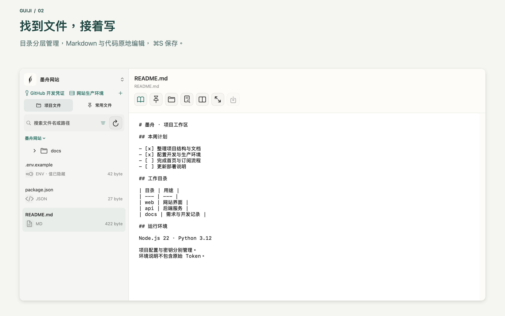

[產品官網 / Product website](https://novatechai.xyz/guiji/) · [繁體中文](https://novatechai.xyz/zh-hant/guiji/)

<div align="center">


# 归记 Guiji · macOS Markdown 编辑器、本地 OCR 与项目凭证工作台

**环境和密码，无需记住，自有归处。**

[](docs/BUILD.md)
[](docs/BUILD.md)
[](Demo/Package.swift)
[-2D735F)](CHANGELOG.md)

**简体中文** · [English](README_EN.md)

[界面预览](#界面预览) · [快速开始](#快速开始) · [典型工作流](#典型工作流) · [常见问题](#常见问题) · [功能与限制](#功能与限制) · [从源码构建](#从源码构建) · [工程结构](#工程结构)

</div>

归记是面向多项目开发的原生 macOS 工作台。在一个窗口里浏览项目、编辑 Markdown、核对运行环境，并把项目关联到本机钥匙串中的凭证。给 Codex、Claude 等工具补充上下文时，可以显式导出带文件入口和配置来源的项目说明。

## 界面预览



界面为示例项目。支持简体中文、繁体中文、英语、西班牙语、土耳其语和日语。

## 快速开始

1. 构建并打开归记，选择语言。
2. 在引导里点「体验示例」，或从工作区菜单打开示例项目。也可以通过「打开项目」授权一个本机文件夹。
3. 选择 `README.md`，点击铅笔进入编辑，修改后点击保存。Markdown 编辑时可打开分栏预览。
4. 在项目卡片中选择「检查配置」，查看识别的运行环境、来源和检查时间。点击钥匙图标管理凭证，按需关联项目。
5. 在示例的 `references/` 中选择 PDF、Office 文档或图片，预览转换结果后另存 Markdown。

## 典型工作流

**继续一个开发项目。** 从项目卡片回到上次工作的目录。把 README、架构说明和交付清单固定为常用文件。需要同时看源码和渲染效果时，在 Markdown 编辑状态打开分栏预览。

**把资料转成 AI 可读的 Markdown。** 在示例的 `references/` 中试转扫描 PDF、Word、Excel、PowerPoint 或图片。文字 PDF 直接提取文本，扫描页和图片在 Mac 上识别。先在预览中检查顺序和代码字符，再导出一个新文件。

**给 Codex 或 Claude 补充项目上下文。** 在项目卡片核对根目录配置和变量名后，主动导出项目说明。把说明与本次任务有关的文件一起提供给工具。说明列出文件入口、环境来源和凭证引用，适合复查上下文来自哪里。

**管理 API Key 和服务器配置。** 在凭证库保存 Token 或密码，关联到需要它的项目，并设置到期与轮换提醒。SSH 记录引用密钥路径。需要让工具执行支持的 GitHub 账户查询时，可从本机服务创建限定项目和有效期的授权，并在任务结束后撤销。

## 常见问题

| 遇到的问题 | 怎么处理 |
| --- | --- |
| 文件搜索没有结果 | 检查筛选，再展开目标目录继续加载。重新选择项目可恢复目录访问授权。 |
| 文件可以读，但保存按钮不可用 | 检查是否进入编辑模式。文件需要是支持的 UTF-8 格式且不超过 2 MB。ENV 保持脱敏只读。 |
| 保存时提示文件已被其他程序修改 | 保留当前草稿，核对磁盘上的新版，再决定如何合并。 |
| 扫描 PDF 转换慢或识别有误 | 尽量使用清晰、方向正确的扫描件。可把多页 PDF 分段转换，并在导出前核对数字、符号和表格。 |
| 临时授权无法使用 | 核对本机服务、关联项目、授权期限和原凭证状态。撤销会阻止后续请求，已经受理的请求可能继续完成。 |
| 本地构建失败 | 确认使用 Apple 芯片 Mac 和支持 Swift 6 的 Xcode，从内置磁盘上的仓库目录运行开发指南的命令。 |

## 功能与限制

| 场景 | 能做什么 | 使用边界 |
| --- | --- | --- |
| 项目管理 | 项目卡片、目录树、常用文件、路径搜索、筛选和排序 | 大目录按批加载，搜索覆盖已加载的文件 |
| 文件编辑 | Markdown、JSON、YAML、TOML、TXT 和常用代码；Markdown 分栏预览 | UTF-8，单文件最大 2 MB。保存时检查外部修改，ENV 脱敏只读 |
| 文档转换 | PDF、DOCX、XLSX、PPTX 与常见图片转换为 Markdown | 单文件 50 MB，PDF 最多 40 页。表格、手写和复杂版式需核对 |
| 本机 OCR | Vision 优先，报错或无结果时使用内置 Tesseract | 六语言模型随包提供，识别后预览再导出 |
| 配置核对 | 从受支持的根目录配置提取环境来源和 ENV 变量名 | 只读检查，结果反映检查时的文件内容 |
| 凭证与授权 | Token、密码、SSH 路径引用、到期提醒、可撤销的临时授权 | 默认关闭本机授权服务。目前授权操作仅支持读取 GitHub 当前账户 |

### 数据与权限

Token 和密码存入应用自有的 macOS 钥匙串条目，关闭同步。SSH 配置保存路径引用。项目说明和环境说明只包含凭证引用及变量名。转换保留原文件，用户确认后另存。可选临时授权通过本机 Unix socket 工作，只有主动执行的 GitHub 账户查询会发出 HTTPS 请求。

[隐私政策](https://hub.novatechai.xyz/nova-context/privacy/) · [产品支持](https://hub.novatechai.xyz/nova-context/support/) · [安全反馈](SECURITY.md)

## 从源码构建

需要 Apple 芯片 Mac、macOS 14 或更新版本，以及支持 Swift 6 的 Xcode。构建和测试在 `Demo/` 执行。

```bash
cd Demo
swift build
swift test
bash scripts/package.sh
```

`package.sh` 默认生成 `Demo/dist/归记.app`，供本机开发验证。App Store 发行使用独立 Xcode 工程和发行签名。详细的构建、测试与 OCR 依赖重建说明见 [开发指南](docs/BUILD.md)。

## 工程结构

| 目录 | 内容 |
| --- | --- |
| `Demo/Sources/NovaContext` | SwiftUI/AppKit 界面、项目导航、编辑器、引导和示例 |
| `Demo/Sources/ContextCore` | 文件访问、配置核对、转换、OCR、本地化和凭证服务 |
| `Demo/Packaging` | App Store 沙箱权限、系统显示名称、隐私清单和开源许可 |
| `Demo/Vendor` | 固定版本的 cmark、ZIPFoundation 和原生 OCR 库 |
| `Demo/Tests` | 文件操作、转换、本地化、凭证授权和界面流程回归测试 |
| `Packages/MiaoYanCore` | 复用的妙言文本处理组件 |

[版本记录](CHANGELOG.md) · [贡献说明](CONTRIBUTING.md) · [产品边界](Demo/design/product-boundary.md) · [本机授权协议](Demo/design/local-service-protocol.md)

## 上游与许可

归记复用 [妙言 MiaoYan](https://github.com/tw93/MiaoYan) 的文本解码及 frontmatter 处理。仓库保留妙言的 MIT 许可和各第三方组件的原始许可。依赖来源及版本见 [上游说明](UPSTREAM.md) 和 [原生 OCR 构建说明](Demo/Packaging/NativeOCR/README.md)。
