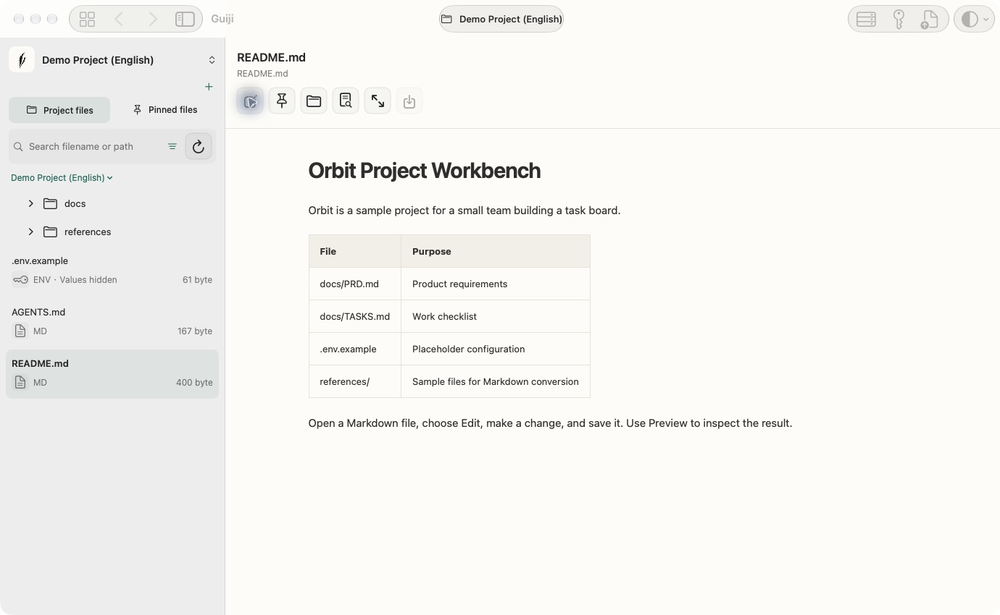

<div align="center">


# Guiji · Markdown & Keys

**A local workspace for project files, Markdown, and credentials on macOS.**

[](docs/BUILD.md)
[](docs/BUILD.md)
[](Demo/Package.swift)

[简体中文](README.md) · **English**

[Preview](#preview) · [First use](#first-use) · [Capabilities](#capabilities) · [Build](#build) · [Source layout](#source-layout)

</div>

Guiji organizes the local files, runtime settings, and credentials you need when switching between development projects. You can edit project notes, verify configuration sources, and export a project brief to supply context to tools such as Codex and Claude.

## Preview



The preview shows sample data. The interface supports English, Simplified Chinese, Traditional Chinese, Spanish, Turkish, and Japanese.

## First use

1. Build and open Guiji, then select your language.
2. Choose **Try a sample** during onboarding or open the sample from the Workspace menu. Use **Open Project** to grant access to a real project folder.
3. Open `README.md`, switch to editing with the pencil button, and save a change. Open the split preview while editing Markdown.
4. Inspect the root configuration from the project card. Use the key button to manage credentials and link entries to your project.
5. Open a PDF, Office document, or image from `references/` to preview a Markdown conversion. Export it to a new file after checking the result.

## Capabilities

| Area | Workflow | Limits |
| --- | --- | --- |
| Project files | Project cards, directory browsing, pins, search, filtering, and sorting | Large directories load in batches. Search covers the loaded files. |
| Editor | Markdown and supported UTF-8 text, configuration, and code files | Up to 2 MB. Saves check for external changes. ENV values stay masked and read-only. |
| Conversion | PDF, DOCX, XLSX, PPTX, and common images to Markdown | Up to 50 MB per input and 40 pages per PDF. Review complex layouts and OCR output. |
| OCR | Apple Vision with a bundled native Tesseract fallback | Six bundled language models. Recognition runs on the Mac. |
| Environment | Inspect recognized root configuration and export variable names or credential references | Inspection reads files without running project scripts. |
| Credentials | App-owned Keychain items, project associations, expiry reminders, and revocable grants | The optional local service starts disabled. The supported grant operation is a GitHub account lookup. |

Tokens and passwords are held in local, unsynced Keychain entries. SSH records keep path references. Exported project briefs and environment descriptions contain references and variable names. A user-initiated GitHub lookup uses outgoing HTTPS through an optional private Unix socket service.

[Support](https://hub.novatechai.xyz/nova-context/support/) · [Privacy policy](https://hub.novatechai.xyz/nova-context/privacy/) · [Security reporting](SECURITY.md)

## Build

Use an Apple silicon Mac with macOS 14 or later and an Xcode toolchain that supports Swift 6.

```bash
cd Demo
swift build
swift test
bash scripts/package.sh
```

The package script creates an ad-hoc signed local app. The App Store workflow uses the Xcode project and separate distribution signing. See the [build guide](docs/BUILD.md) for test switches, native OCR rebuilds, and release validation.

## Source layout

- `Demo/Sources/NovaContext` contains the app UI, onboarding, and sample projects.
- `Demo/Sources/ContextCore` implements file access, editing, document conversion, OCR, localization, and local grants.
- `Demo/Packaging` contains signing configuration, system-name localization, privacy declarations, and license notices.
- `Demo/Tests` contains functional regression tests.
- `Demo/Vendor` and `Packages/MiaoYanCore` hold the pinned dependencies.

[Changelog](CHANGELOG.md) · [Contributing](CONTRIBUTING.md) · [Upstream and licenses](UPSTREAM.md)
